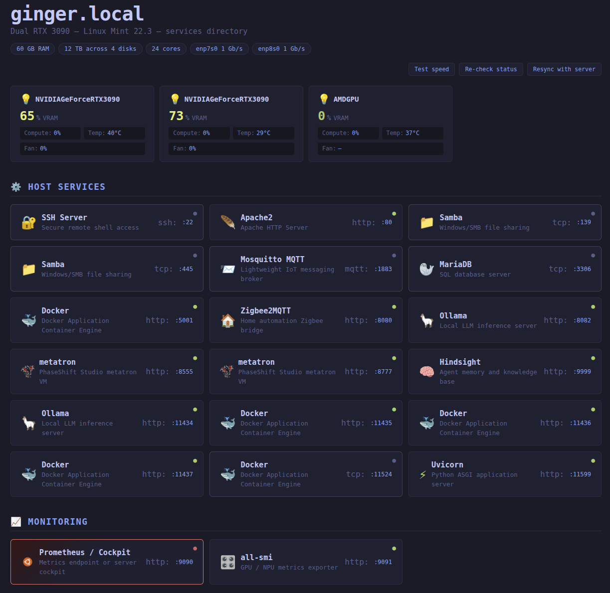

# server-splash

**A live dashboard of everything running on your server — generated from what is
actually there, not from a config file you have to keep up to date.**



Point it at a Linux box and it produces a single page listing every service it can
find, with the right name, a sensible icon, and a status light that reflects reality.
Add a service and it appears on the next refresh. No HTML, no service list, no
bookkeeping.

---

## Features

**Finds things you forgot you were running.** It reads the host's listening sockets,
systemd units, Docker containers and `nvidia-smi`, then merges them by port. A service
that is neither a systemd unit nor a published container port still shows up, because
it is listening.

**Names them properly.** ~80 services are recognised by container name, systemd unit,
process, image or the page's own `<title>` — Apache gets a feather, PostgreSQL an
elephant, Home Assistant a house. Anything still unknown borrows its own favicon. Only
genuinely anonymous services fall back to a generic globe.

**Live status, not a build-time snapshot.** Every card re-checks itself from your
browser, so a service that goes down goes red without regenerating anything. The state
at generation time is baked in too, so the page is still useful with JavaScript off.

**GPU panels.** VRAM, utilisation, temperature and fan for each card, filled in from
`nvidia-smi` at generation time and refreshed live from [Glances][glances] if you run it.

**Machine panel.** CPU usage, load average and RAM used, beside the GPU cards. Sampled
from `/proc` when the page is generated, so it is there without JavaScript, and
refreshed live from Glances when one is configured.

**System stats.** `64 GB RAM · 12 TB across 4 disks · 24 cores · eno1 1 Gb/s` under the
title, from `/proc`, `lsblk` and `/sys`.

**A speed test.** One button measures your browser's link to the server — the number
that actually matters for a LAN dashboard.

**Resync.** A button re-probes the host for services that started since the page was
generated. (A browser cannot enumerate ports, so it explores a list of ~140 common
ones; anything else needs a refresh, which the container does on a timer.)

**Curation that survives regeneration.** Rename, re-icon, regroup or hide anything in
`overrides.toml`. The generated HTML is never the source of truth, so regenerating
never loses your edits.

**Never destroys what it replaces.** Before deploying over an existing page it copies
what it is about to overwrite, and prints the restore command.

**No LLM required.** Discovery is deterministic and offline. If you happen to run
Ollama it will suggest names for the handful of services the catalog does not know —
strictly optional, and it may not overwrite a curated name or icon.

---

## Install

### Docker (recommended)

```bash
git clone https://github.com/phaseshift-studio/server-splash
cd server-splash
docker compose up -d
```

Then open **http://localhost:6420**.

That is the whole thing — the container discovers the host, regenerates every 15
minutes, and serves the page itself. No web server to configure, no document root to
find, no file ownership to get right.

> **The one thing to know:** `network_mode: host` and `pid: host` are required, and
> `docker-compose.yml` already sets them. Discovery reads *the host's* listening
> sockets; inside a private network namespace the container would only ever see itself.

**What it can see from inside a container**

| | |
| --- | --- |
| Listening ports | yes — host network namespace |
| Process names | yes — host PID namespace |
| Docker containers | yes — via the mounted socket |
| systemd unit names | yes — via the mounted D-Bus socket |
| Its own name | yes — via `uts: host`, so links point at the machine, not the container id |
| Distribution name | yes — via the mounted `/etc/os-release` |
| GPUs | only with the `deploy:` block in the compose file uncommented |

To run the published image rather than building locally, delete the `build:` line from
`docker-compose.yml`:

```yaml
image: ghcr.io/phaseshift-studio/server-splash:latest
```

### From source (Rust)

Needs a Rust toolchain (edition 2021) and nothing else:

```bash
cargo build --release
sudo install -m0755 target/release/splash /usr/local/bin/
splash --serve
```

Or generate once and exit:

```bash
splash --auto --hostname "$(hostname).local" --deploy /var/www/html
```

[glances]: https://github.com/nicolargo/glances

---

## Configuration

Everything is optional. Command-line flags beat environment variables, which beat the
config file, which beats the defaults.

### Environment variables

These exist so a container needs no config file — see `docker-compose.yml`.

| Variable | Default | What it does |
| --- | --- | --- |
| `SPLASH_HOSTNAME` | this machine's hostname | How the dashboard is reached. A bare name gets `.local` appended. |
| `SPLASH_PORT` | `6420` | Serve the page here. `0` generates once and exits. |
| `SPLASH_INTERVAL` | `900` | Seconds between rediscoveries. `0` never refreshes. |
| `SPLASH_DEPLOY` | – | Also copy the finished page here, e.g. `/var/www/html`. |
| `SPLASH_GLANCES` | – | Glances API base, e.g. `http://ginger.local:61208`. |
| `SPLASH_EXCLUDE_PORTS` | – | Ports to leave off the page, e.g. `"8080,443"`. |
| `SPLASH_TITLE` | the hostname | Page heading. |
| `SPLASH_SUBTITLE` | from the hardware | Line under the heading. |
| `SPLASH_AGENT_URL` | `http://127.0.0.1:11434` | OpenAI-compatible endpoint for optional naming. |
| `SPLASH_NO_AGENT` | `false` | Never call an LLM. |
| `SPLASH_INCLUDE_LOOPBACK` | `false` | Also list services bound to `127.0.0.1` only. |
| `SPLASH_INCLUDE_EPHEMERAL` | `false` | Also list ports 32768–60999 (usually test noise). |
| `SPLASH_SPEEDTEST_BYTES` | `8388608` | Speed-test payload size; `0` removes the button. |
| `SPLASH_INLINE_ICONS` | `true` | Embed icons in the page rather than writing `icons/`. |
| `SPLASH_MODULES` | – | Sub-dashboards to build: `"Ollama Dashboard"`, `"systemd"`, `"cron"`. |
| `SPLASH_OVERRIDES` | `~/.config/server-splash/overrides.toml` | Curation rules. |
| `SPLASH_OUTPUT_DIR` | `./server-splash` | Where the page is written. |
| `SPLASH_BACKUP_DIR` | `~/.local/share/server-splash/backups` | Pre-deploy backups. |

> **`SPLASH_GLANCES` is fetched by your browser, not by the server.** `localhost` there
> means *your* machine, so the GPU and machine panels would silently stay at their
> generation-time values. Use the address you reach the dashboard on. The tool warns
> when it sees a loopback URL.

### Config file

`~/.config/server-splash/splash-config.toml`, or pass `--config <file>`. Same settings,
TOML spelling:

```toml
hostname = "ginger.local"
port = 6420
interval = 900
deploy_path = "/var/www/html"
glances_api_base = "http://ginger.local:61208"
exclude_ports = [80]
title = "Home Server"
```

### Curating the result

Discovery gets the ports right; it cannot know your taste. Generate a starter file:

```bash
splash --scaffold
```

That writes one rule per discovered service. Edit freely — the first match that
supplies a field wins, and unset fields fall back to the built-in catalog:

```toml
[[service]]
port = 8080
name = "Zigbee2MQTT"
desc = "Home automation Zigbee bridge"
icon = "🏠"

# …or match on the container / unit / process name.
[[service]]
match = "ollama"
icon = "🦙"

# Hide something without deleting anything.
[[service]]
port = 445
hidden = true
```

`icon` may be an emoji, an image path (`icons/my-logo.png`) or a URL.

---

## Deployment

### Serving itself (default)

`splash --serve` regenerates on an interval and serves the result. This is what the
container runs, and nothing else is needed.

### Into an existing web server

If Apache or nginx already owns port 80, generate into its document root instead:

```bash
splash --auto --hostname ginger.local --deploy /var/www/html
```

`splash` backs up everything it overwrites and tells you how to undo it:

```
Deploying to: /var/www/html
  kept index.html
  backed up 1 existing file(s) to /root/.local/share/server-splash/backups/2026-10-16_155733
  restore with: cp -r /root/.local/share/server-splash/backups/2026-10-16_155733/. /var/www/html
```

For an archive of the whole site — not just the file being replaced — there is
`scripts/backup-site.sh`, useful before a first deploy or when several pages might be
affected:

```bash
scripts/backup-site.sh --host http://ginger.local --out backups
```

It records the HTTP status, size, SHA-256 and `Last-Modified` of each path, then
re-fetches everything and compares, so a truncated backup is caught immediately rather
than when it is needed.

### On a schedule

Ship the included unit files to regenerate every 15 minutes:

```bash
sudo cp deploy/splash.service deploy/splash.timer /etc/systemd/system/
sudo systemctl edit splash.service      # set your paths
sudo systemctl enable --now splash.timer
```

Or just use cron:

```cron
*/15 * * * * /usr/local/bin/splash --auto --deploy /var/www/html >/dev/null 2>&1
```

### Sub-dashboards

Three ship with the tool. Each generates its own page under the output directory and gets
a card on the main dashboard:

| Module | What it is | Backend |
| --- | --- | --- |
| `Ollama Dashboard` | Models, chat and VRAM metrics for a local Ollama | talks to Ollama directly (default `:11434`) |
| `systemd` | Browse, start and stop systemd units | `backend.py` on `:9870` |
| `cron` | Browse and edit cron jobs | `backend.py` on `:9871` |

The two management panels are a static page plus a small Python service, which is
written next to the page when the module is generated:

```bash
SPLASH_MODULES="systemd,cron" splash --auto --output /var/www/html
python3 /var/www/html/systemd/backend.py      # serves the REST API the page calls
```

The backends use only the Python standard library — no packages to install. They shell
out to `systemctl` and `crontab`, so **they must run on the host, not in the container**:
the image has no systemd. In a container the generated pages still work, but those two
panels will report that their backend is unreachable.

---

## How it works

Four independent sources, merged by port:

1. **Listening TCP sockets** (`ss -ltnp`, falling back to `/proc/net/tcp*`) — the ground
   truth for "something is serving here right now".
2. **systemd units** — a human description for a port's process.
3. **Docker containers** — a name and image for published ports.
4. **`nvidia-smi`** — GPU inventory, used for the page subtitle.

Each port is then asked what it is over HTTP, which classifies it and picks up the
page's `<title>`. Loopback-only services are listed but not linked, and the dynamic port
range is skipped because it is mostly short-lived test sockets.

Deeper detail — the icon precedence ladder, what the resync button can and cannot find,
authoring a sub-dashboard module — is in [docs/DESIGN.md](docs/DESIGN.md).

---

## Development

```bash
cargo test                        # 80+ tests, no network or daemons required
cargo clippy --all-targets
cargo run -- --auto --no-agent --output /tmp/preview
```

The parsers are pure functions over captured command output, so the suite runs anywhere
— including on a machine with no Docker, no systemd and no GPU.

## Licence

MIT — see [LICENSE](LICENSE).
